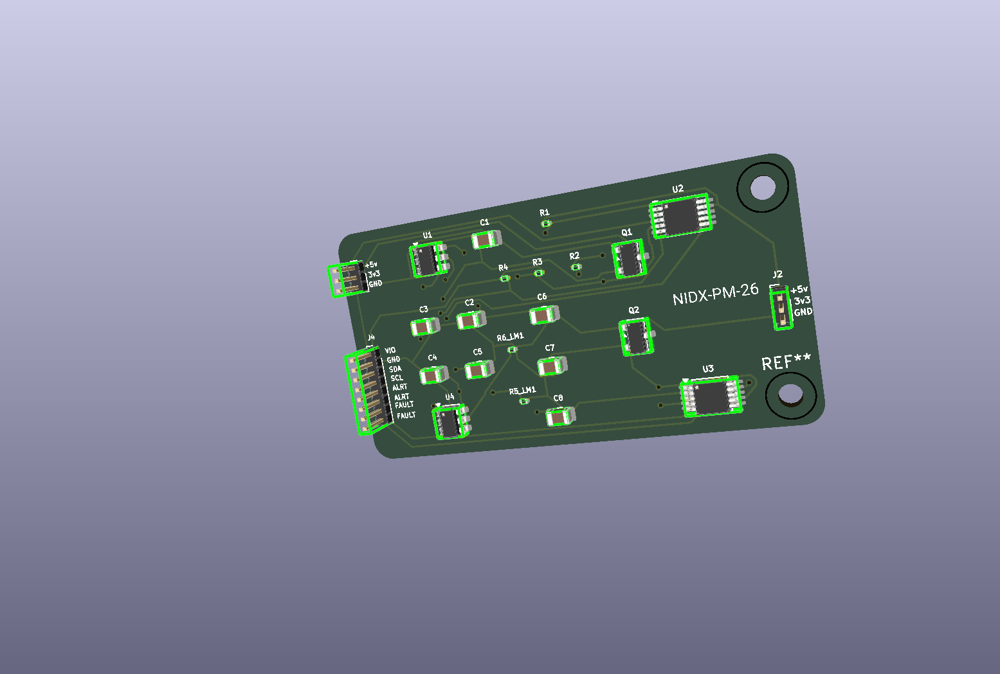

<!-- boardrepo-badge:v1 -->
[](https://boardrepo.com/b/abe7d2d4-ddd6-4d37-b60d-a06ef9e4d622?ref=github-readme)
<!-- /boardrepo-badge:v1 -->

# NIDX-PM-26: Dual-Channel MCU Power Management & Protection Module



**NIDX-PM-26** is a dual-channel power distribution, circuit protection, and telemetry module designed by **NileDex** for microcontrollers (MCUs), development boards (ESP32, STM32, Arduino, Raspberry Pi), and sensitive embedded systems.

The module provides active reverse polarity protection, programmable current-limiting switches with hardware fault flags, and high-precision 20-bit digital power monitoring (voltage, current, power, and energy accumulation) over a shared I2C bus.

---

## Key Features

- **Dual Independent Channels**: Two isolated power paths (Channel 1 & Channel 2) capable of operating from independent or common supply rails.
- **Active Reverse Polarity Protection**: Low-$R_{DS(on)}$ P-Channel MOSFETs (`AO3401A`) prevent reverse-voltage damage with negligible voltage drop compared to traditional Schottky diodes.
- **Precision Electronic Current Limiting & Load Switching**: Integrated Texas Instruments `TPS2553DBVR` power switches with programmable current limit threshold, fast short-circuit response, and thermal shutdown with auto-recovery.
  - Set to **~500 mA** per channel ($R_{ILIM} = 47\text{ k}\Omega$), adjustable from 75 mA to 1.7 A by changing resistor values.
- **High-Resolution Power Telemetry (INA228)**: Dual 20-bit Delta-Sigma ADCs monitoring bus voltage, shunt voltage, bidirectional current, and power consumption with high accuracy.
- **Hardware Fault & Alert Reporting**: Dedicated open-drain `FAULT` (TPS2553) and programmable `ALERT` (INA228) outputs broken out for direct microcontroller interrupt handling.
- **Flexible Logic Level Compatibility**: On-board I2C pull-up resistors are tied to an external `VDD_I2C` pin, allowing seamless operation with 1.8V, 3.3V, or 5V microcontroller logic.

---

## System Architecture

```
                  CHANNEL 1
J1 Pin 1 ──► [Q1: AO3401A] ──► [U1: TPS2553] ──► [R1: 0.1Ω Shunt] ──► J2 Pin 1
 (VIN1)     (Reverse Protect)  (Current Limit)             │          (VOUT1)
                                      │                    ▼
                                      │              [U2: INA228]
                                      ▼             (20-bit I2C: 0x40)
                              FAULT1 ──► J4 Pin 7          │
                                                    ALERT1 ──► J4 Pin 5

                  CHANNEL 2
J1 Pin 2 ──► [Q2: AO3401A] ──► [U4: TPS2553] ──► [R2: 0.1Ω Shunt] ──► J2 Pin 2
 (VIN2)     (Reverse Protect)  (Current Limit)             │          (VOUT2)
                                      │                    ▼
                                      │              [U3: INA228]
                                      ▼             (20-bit I2C: 0x44)
                              FAULT2 ──► J4 Pin 8          │
                                                    ALERT2 ──► J4 Pin 6

                  CONTROL & I2C INTERFACE (J4)
J4 Pin 1 ──► VDD_I2C (Pull-up Reference: 1.8V - 5V)
J4 Pin 2 ──► GND
J4 Pin 3 ──► SDA (Shared I2C Data bus, 4.7kΩ pull-up R3)
J4 Pin 4 ──► SCL (Shared I2C Clock bus, 4.7kΩ pull-up R4)
```

---

## Detailed Circuit Design

### 1. Reverse Polarity Protection (`Q1`, `Q2`)
- **Part**: Alpha & Omega `AO3401A` (-30V, -4.0A, SOT-23 P-Channel MOSFET).
- **Function**: Gate tied to GND; Source connects to the circuit rail, and Drain connects to the input power connector.
- **Behavior**: If reverse voltage is applied ($V_{IN} < 0\text{V}$), $V_{GS} > 0\text{V}$ keeps the MOSFET off, completely blocking reverse current. When correct polarity is applied, the channel turns fully on with $R_{DS(on)} \approx 44\text{ m}\Omega$, minimizing power loss and voltage sag.

### 2. Overcurrent Protection & Load Switching (`U1`, `U4`)
- **Part**: Texas Instruments `TPS2553DBVR` (SOT-23-6).
- **Operation**: Active-high enable (`EN`) tied to `IN` for automatic power pass-through.
- **Current Limit Programming**:
  The trip current is set by $R_{ILIM}$ resistors `R5_LM1` and `R6_LM1` ($47\text{ k}\Omega$):
  $$I_{OS(typ)} \approx \frac{24212}{(R_{ILIM})^{0.985}} \approx \frac{24212}{(47000)^{0.985}} \approx 595\text{ mA}$$
  (Nominal continuous working current: $\sim 500\text{ mA}$).
- **Fault Detection**: The active-low open-drain `FAULT` pin signals over-current or thermal shutdown events to the host MCU via `J4`.

### 3. Precision Current & Power Sensing (`U2`, `U3`)
- **Part**: Texas Instruments `INA228` (TSSOP-10).
- **Resolution**: 20-bit Delta-Sigma ADC with $1\text{ }\mu\text{V}$ shunt voltage LSB and $195.3125\text{ }\mu\text{V}$ bus voltage LSB.
- **Current Sense Resistors**: `R1`, `R2` = $0.1\text{ }\Omega$ ($100\text{ m}\Omega$, 0805 SMD package).
- **I2C Addressing**:
  | Channel | IC Designator | A1 Pin | A0 Pin | 7-bit I2C Address (Hex) | 7-bit I2C Address (Binary) |
  |---------|---------------|--------|--------|-------------------------|----------------------------|
  | **Ch 1** | `U2` | GND | GND | `0x40` | `1000000b` |
  | **Ch 2** | `U3` | VS (Rail) | GND | `0x44` | `1000100b` |

- **Alert Pins**: Open-drain output asserted when programmed power, current, or voltage limits are exceeded.

---

## Connector Pinouts

### J1: Input Power Connector (1x03 Pin Header, 1.00mm Pitch)
| Pin # | Silkscreen | Signal | Type | Description |
|:-----:|:----------:|:------:|:----:|:------------|
| 1 | `+5v` | `VIN1` | Power Input | Channel 1 Input Voltage (+2.5V to +6.5V) |
| 2 | `3v3` | `VIN2` | Power Input | Channel 2 Input Voltage (+2.5V to +6.5V) |
| 3 | `GND` | `GND` | Ground | Common Power Ground |

### J2: Output Power Connector (1x03 Pin Header, 1.00mm Pitch)
| Pin # | Silkscreen | Signal | Type | Description |
|:-----:|:----------:|:------:|:----:|:------------|
| 1 | `+5v` | `VOUT1` | Power Output | Channel 1 Protected & Monitored Power Output |
| 2 | `3v3` | `VOUT2` | Power Output | Channel 2 Protected & Monitored Power Output |
| 3 | `GND` | `GND` | Ground | Common Power Ground |

### J4: Telemetry & Diagnostics Interface (1x08 Pin Header, 1.00mm Pitch)
| Pin # | Silkscreen | Signal | Type | Description |
|:-----:|:----------:|:------:|:----:|:------------|
| 1 | `VIO` | `VDD_I2C` | Power Input | I2C pull-up reference voltage (1.8V, 3.3V, or 5V MCU logic) |
| 2 | `GND` | `GND` | Ground | System Ground reference for digital signals |
| 3 | `SDA` | `SDA` | I/O | I2C Data line (pulled up via `R3` $4.7\text{ k}\Omega$ to `VIO`) |
| 4 | `SCL` | `SCL` | Input | I2C Clock line (pulled up via `R4` $4.7\text{ k}\Omega$ to `VIO`) |
| 5 | `ALRT` | `ALERT1` | Output (OD) | Channel 1 INA228 programmable threshold alert |
| 6 | `ALRT` | `ALERT2` | Output (OD) | Channel 2 INA228 programmable threshold alert |
| 7 | `FAULT` | `FAULT1` | Output (OD) | Channel 1 TPS2553 fault flag (Active Low) |
| 8 | `FAULT` | `FAULT2` | Output (OD) | Channel 2 TPS2553 fault flag (Active Low) |

---

## Electrical Specifications

| Parameter | Min | Typical | Max | Unit | Notes |
|:----------|:---:|:-------:|:---:|:----:|:------|
| **Input Voltage ($V_{IN}$)** | 2.5 | 3.3 / 5.0 | 6.5 | V | Limited by TPS2553 supply range |
| **Current Limit Threshold ($I_{LIMIT}$)** | 450 | 500 | 600 | mA | Configured by $47\text{ k}\Omega$ $R_{ILIM}$ resistors |
| **Current Sense Resistance ($R_{SHUNT}$)** | - | 0.1 | - | $\Omega$ | Tolerance 1%, 0805 package |
| **Reverse Polarity Voltage Blocking** | - | - | -30 | V | $V_{DS(max)}$ of AO3401A |
| **I2C Bus Speed** | 10 | 400 | 1000 | kHz | Standard, Fast, and Fast-Mode+ supported |
| **Digital Logic Voltage (`VDD_I2C`)** | 1.8 | 3.3 | 5.5 | V | Feeds pull-ups `R3` and `R4` |
| **Operating Ambient Temperature** | -40 | +25 | +85 | °C | Industrial rated components |

---

## Bill of Materials (BOM)

| Designator | Value / Part Number | Description | Footprint / Package |
|:-----------|:--------------------|:------------|:--------------------|
| **U1, U4** | `TPS2553DBVR` | Precision Adj. Current-Limited Switch | SOT-23-6 |
| **U2, U3** | `INA228` | 20-bit Current/Power/Energy Monitor | TSSOP-10 (3x3mm, 0.5mm pitch) |
| **Q1, Q2** | `AO3401A` | P-Channel MOSFET (-30V, -4.0A) | SOT-23-3 |
| **R1, R2** | `0.1` ($100\text{ m}\Omega$) | Current Shunt Resistor, 1% | SMD 0805 |
| **R3, R4** | `4.7k` | I2C Bus Pull-Up Resistors | SMD 0805 |
| **R5_LM1, R6_LM1** | `47k` | Current Limit Set Resistors (TPS2553) | SMD 0805 |
| **C1, C2, C3, C4** | `100n` ($0.1\text{ }\mu\text{F}$) | Ceramic Decoupling Capacitors, 50V | SMD 0805 |
| **C5, C6, C7, C8** | `10u` ($10\text{ }\mu\text{F}$) | Ceramic Bulk Filter Capacitors, 16V/25V | SMD 0805 |
| **J1, J2** | `Conn_01x03` | 3-pin Power Input/Output Header | 1x03 Pin Header (1.00mm pitch) |
| **J4** | `Conn_01x08` | 8-pin Diagnostics & Telemetry Header | 1x08 Pin Header (1.00mm pitch) |

---

## Firmware Integration Example (Arduino / C++)

```cpp
#include <Wire.h>

// I2C Addresses
#define INA228_CH1_ADDR 0x40
#define INA228_CH2_ADDR 0x44

// Pin Definitions on Host MCU
#define PIN_FAULT1 4
#define PIN_FAULT2 5
#define PIN_ALERT1 6
#define PIN_ALERT2 7

void setup() {
  Serial.begin(115200);
  Wire.begin();

  pinMode(PIN_FAULT1, INPUT_PULLUP);
  pinMode(PIN_FAULT2, INPUT_PULLUP);
  pinMode(PIN_ALERT1, INPUT_PULLUP);
  pinMode(PIN_ALERT2, INPUT_PULLUP);

  Serial.println("NIDX-PM-26 Initialized.");
}

void loop() {
  // Check for TPS2553 hardware fault (Active LOW)
  if (digitalRead(PIN_FAULT1) == LOW) {
    Serial.println("WARNING: Channel 1 Over-Current or Thermal Fault detected!");
  }
  if (digitalRead(PIN_FAULT2) == LOW) {
    Serial.println("WARNING: Channel 2 Over-Current or Thermal Fault detected!");
  }

  // Read voltage & current telemetry via I2C (INA228)
  readTelemetry(INA228_CH1_ADDR, "Channel 1");
  readTelemetry(INA228_CH2_ADDR, "Channel 2");

  delay(1000);
}

void readTelemetry(uint8_t address, const char* channelName) {
  // Read VBUS Register (0x05 for INA228)
  Wire.beginTransmission(address);
  Wire.write(0x05);
  if (Wire.endTransmission() == 0) {
    Wire.requestFrom(address, (uint8_t)3);
    if (Wire.available() >= 3) {
      uint32_t rawVbus = ((uint32_t)Wire.read() << 16) | ((uint32_t)Wire.read() << 8) | Wire.read();
      rawVbus >>= 4; // 20-bit data alignment
      float voltage = rawVbus * 195.3125e-6; // 195.3125 uV/LSB
      Serial.print(channelName);
      Serial.print(" Voltage: ");
      Serial.print(voltage, 3);
      Serial.println(" V");
    }
  }
}
```

---

## Repository Structure

```
mcu-protection/
├── .gitignore                     # Git ignore rules (schematics, netlists & temporary files ignored)
├── LICENSE                        # MIT License
├── README.md                      # Hardware documentation and wiring guide
├── mcu-protection.kicad_pro       # KiCad 10 project file
├── mcu-protection.kicad_pcb       # KiCad PCB layout
├── mcu-protection.png             # PCB 3D preview render
└── ERC.rpt                        # Electrical Rules Check report
```

---

## License

This project is licensed under the [MIT License](LICENSE).
Copyright (c) 2026 NileDex (NIDX-PM-26 Contributors).
